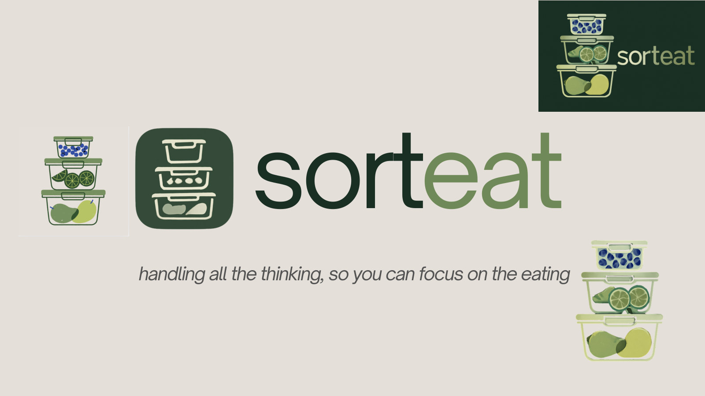
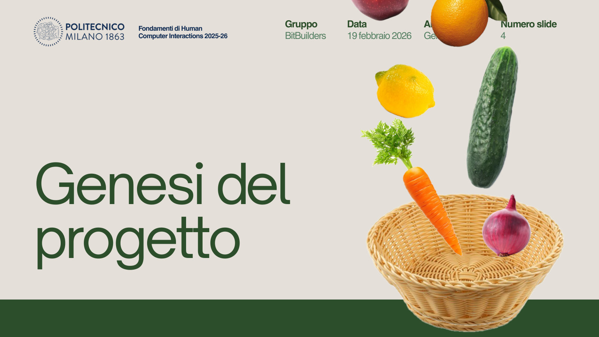
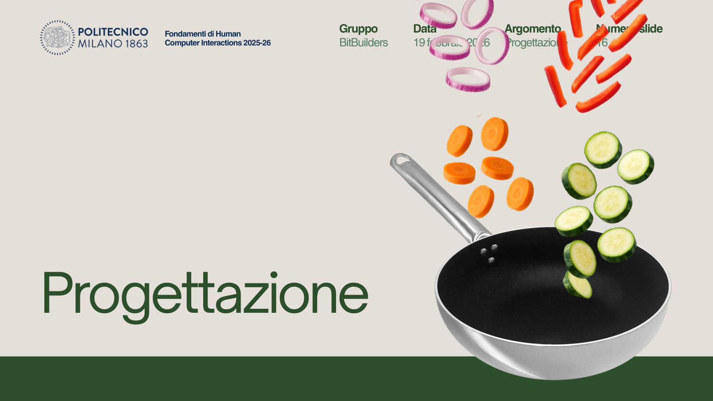
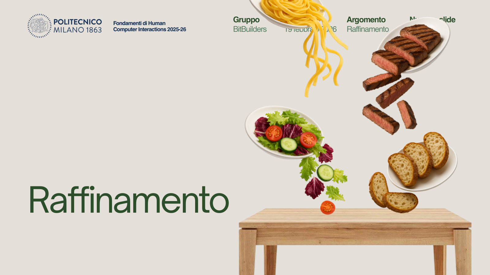
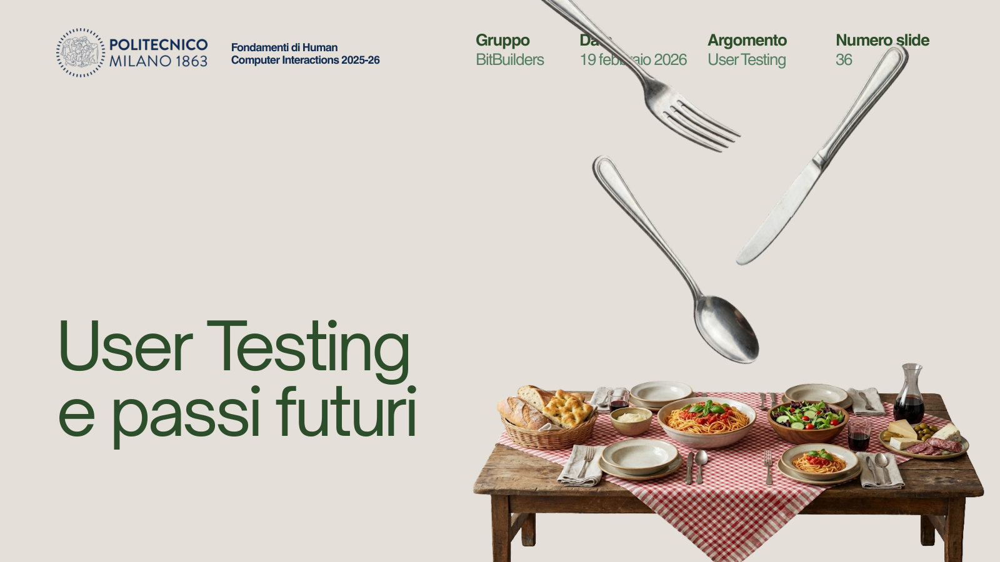
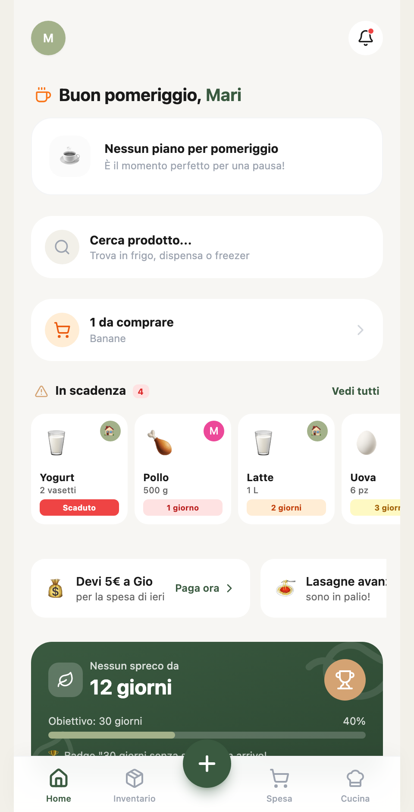
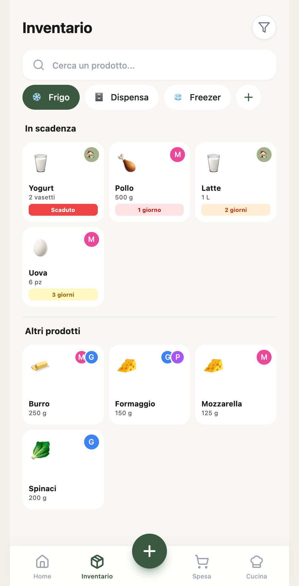
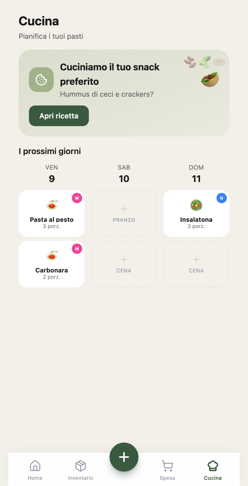
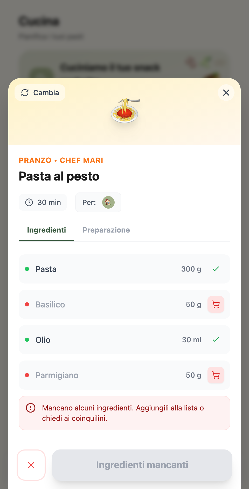

# Sorteat

A high-fidelity React prototype for shared households: track what's in the fridge, split the shopping, and plan meals around what you already have.

> *Handling all the thinking, so you can focus on the eating.*

**[▶ Live demo](https://sorteat-high-fidelity.vercel.app/)** · Interface language: Italian

---

## Problem

Most food waste at home isn't caused by carelessness — it's caused by *not knowing*. In a shared flat nobody has a reliable picture of what's already in the fridge, who bought it, or what is about to go off. The result is duplicate purchases, forgotten leftovers, and food thrown away while someone is out buying the same thing again.

The underlying cost is cognitive, not just financial. Keeping track of stock, expiry dates, whose food is whose, and what can actually be cooked tonight is continuous mental overhead that nobody wants to own.

Sorteat explores how a shared, always-visible view of the household's food can reduce both the waste and the mental effort behind it.

---

## Product

Four connected areas, all working against a shared in-memory store.

### 🏠 Home
A daily overview: a greeting tied to the time of day, what's expiring soon, how many items are on the shopping list, a product search across all storage zones, and an anti-waste streak counter with a progress goal. Household reminders (e.g. money owed for a shared shop, leftovers up for grabs) surface here too.

### 📦 Inventory
Stock split across **fridge, pantry and freezer**, with search and filters. Every product carries a quantity, a unit, an expiry state, and an **owner** — a specific flatmate or the household. Opening a product gives four actions:

- **consume** a specific quantity
- **ask to borrow** it from whoever owns it (*"Chiedi in prestito"*)
- **edit** it
- **delete** it

### 🛒 Shopping
A single shared list grouped by supermarket department, where each item is assigned to one or more flatmates. A multi-step checkout reviews quantities, confirms owners, simulates scanning the receipt, and moves everything into the inventory in the right storage zone.

### 👨‍🍳 Kitchen
A multi-day meal planner with lunch and dinner slots, each assignable to a flatmate. Opening a planned meal runs every ingredient against the live inventory and marks it:

| Status | Meaning | Action offered |
|---|---|---|
| 🟢 `ok` | enough of it in stock | — |
| 🔴 `buy` | missing or not enough | add to the shopping list in one tap |
| 🟡 `ask` | a flatmate owns it | ask them for it |

The check is unit-aware: it converts between compatible mass and volume units, so 300 g requested against 1 kg in the pantry resolves correctly. The "cook now" action only unlocks when every ingredient is green, and cooking consumes the ingredients from the inventory.

### Adding products
Three entry points: **manual entry** (full form), **receipt scanning** and **voice input** — the latter two are simulated, see *Prototype limitations*.

---

## HCI process

Sorteat was a six-person team project (*BitBuilders*) for the Human-Computer Interaction course at Politecnico di Milano, A.Y. 2025/26. The research and design process was collaborative:

- **Semi-structured interviews** for needfinding
- **2 in-person focus groups**
- **Iterative prototyping**: low-fidelity wireframes, then a mid-fidelity Figma prototype, then this high-fidelity build
- **Nielsen heuristic evaluation**, received from a peer team and used to redesign the prototype (the team also evaluated another team's project)
- **Usability testing** with **11 participants**

**Average usability score: SUS 89/100. Final academic project grade: 30/30 cum laude.**
Both results belong to the team project as a whole.

The full process, the deliverables and the team's commit history are preserved in the original project:

- **[Final HCI project website](https://porkyphoenix091.github.io/BitBuilders/)**
- **[Original team repository](https://github.com/PorkyPhoenix091/BitBuilders)**

---

## My contribution

I was the sole human developer of the Sorteat high-fidelity React application, built as part of a six-person Human-Computer Interaction project at Politecnico di Milano. The app was started from a [Base44](https://base44.com) project, an AI-assisted app-building platform, and Base44's SDK and Vite plugin are still part of the build (see *Tech stack*).

- **Product ideation and UX/UI design**, from the concept to the high-fidelity interface
- **Team leader** of the BitBuilders academic team; **moderated 7 of the 11 usability testing sessions**
- **Visual identity**: digitally hand-illustrated the original Sorteat logo, which is also the app icon
- **Presentations and storytelling**: wrote and designed all of the team's academic presentations, structuring how the research, design decisions and results were communicated at each deliverable
- **Maintained the team repository and project website**

The research, the evaluations and the other course deliverables were team work by all six members.

### Visual identity & storytelling



*The original Sorteat logo, hand-drawn digitally: stacked food containers in two illustrated renderings, a simplified line-art app icon, and the two-tone* sort·eat *wordmark. [Logo artwork (PDF)](docs/branding/sorteat-logo.pdf)*

Across the course deliverables I used food as a running metaphor for how the product developed. Ingredients are collected, then prepared, then served, then the table is set:

| 01 Discovery | 02 Design |
|---|---|
|  |  |
| Ingredients collected | Ingredients prepared |

| 03 Refinement | 04 Testing |
|---|---|
|  |  |
| Dishes come together | A complete meal |

*Section slides from the final presentation, 19 February 2026 ([PDF](docs/storytelling/presentazione-finale-section-slides.pdf)). The concept, compositions, layout and copy are mine. The food photographs are existing image assets, not my own photography or illustration.*

---

## Screenshots

| Home | Inventory |
|---|---|
|  |  |
| Expiring items, shopping count and the anti-waste streak | Fridge / pantry / freezer, with per-flatmate ownership |

| Meal planner | Ingredient availability |
|---|---|
|  |  |
| Lunch and dinner slots, assigned per flatmate | Each ingredient checked against the inventory |

---

## Prototype limitations

This is a **design prototype**, scoped deliberately. Stated plainly so nothing here is mistaken for production capability:

- **Receipt scanning is simulated.** The flow mimics a camera capture and returns a predefined set of products. There is **no OCR and no image processing**.
- **Voice input is simulated.** It animates a fixed, hardcoded phrase. There is **no speech recognition and no audio capture**.
- **No AI or machine learning features in the app.** At runtime there is no model inference and no call to an external AI service.
- **Data is mock data held in memory.** State lives in React Context, seeded with sample products, meals and a shopping list. **Changes are lost on page reload** — there is no backend, no database and no persistence.
- **Single simulated user.** The app acts as one flatmate ("Mari"); the others exist as data, not as real accounts. There is no authentication.
- Some secondary actions are placeholders that surface a *"coming soon"* message rather than a built flow.

---

## Tech stack

| | |
|---|---|
| **Framework** | React 18 |
| **Build tool** | Vite 6 |
| **Styling** | Tailwind CSS 3 |
| **Animation** | Framer Motion |
| **State** | React Context API (`ProductsContext`, `WasteContext`) |
| **Routing** | React Router |
| **UI primitives** | Radix UI / shadcn-style components |
| **Icons** | Lucide |
| **Notifications** | Sonner |
| **Charts** | Recharts |
| **Scaffolding** | Base44 project template: `@base44/sdk` and `@base44/vite-plugin` are still dependencies (legacy auth and navigation wiring). The prototype's data is local mock data only. |

```
src/
├── pages/          10 screens (Home, Inventario, Spesa, Cucina, …)
├── components/
│   ├── home/       dashboard widgets
│   ├── inventory/  product cards, detail modal, filters
│   ├── spesa/      shopping list, checkout, owner assignment
│   ├── cucina/     meal planner, recipe modals
│   └── ui/         shared primitives
├── context/        ProductsContext, WasteContext
└── entities/       data shapes (Product, ShoppingItem, MealPlan, Notification)
```

---

## Local setup

Requires Node.js 18+.

```bash
git clone https://github.com/mariisarbash/sorteat_high_fidelity.git
cd sorteat_high_fidelity
npm install
npm run dev
```

The app runs at `http://localhost:5173`.

| Script | Purpose |
|---|---|
| `npm run dev` | start the dev server |
| `npm run build` | production build to `dist/` |
| `npm run preview` | preview the production build |
| `npm run lint` | run ESLint |

---

## Related

- **[BitBuilders: final project website](https://porkyphoenix091.github.io/BitBuilders/)** · **[team repository](https://github.com/PorkyPhoenix091/BitBuilders)**: the six-person team's original HCI project, with the research, prototypes, evaluations, usability testing and full contribution history.
- [sorteat_website](https://github.com/mariisarbash/sorteat_website): an earlier personal snapshot of the project website (November 2025), kept for reference.
